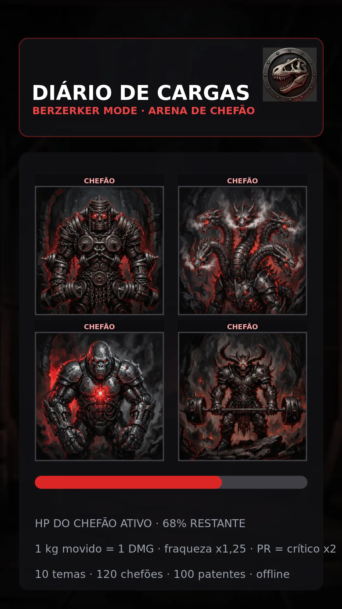
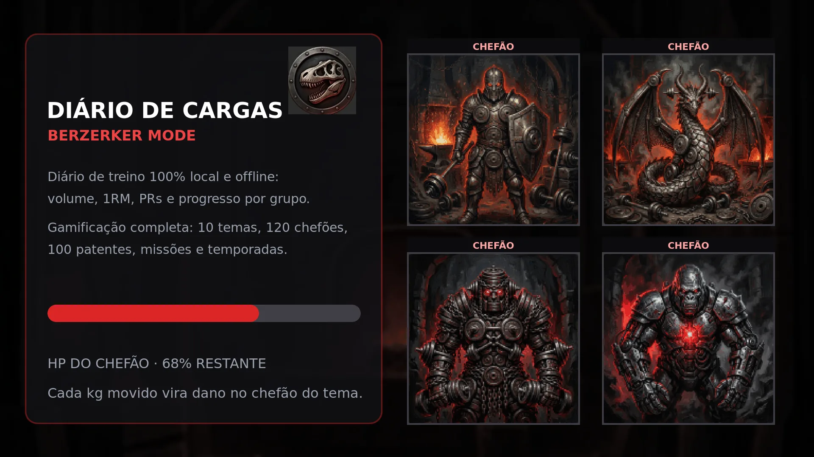

# Diário de Cargas // Berzerker Mode

PWA 100% local para registrar cargas, treinos e evolução — com gamificação (XP, patentes,
chefões, missões e temporadas), integração com a planilha de treino e um pool de exercícios
com tags. Sem backend, sem conta, sem nuvem: tudo vive no `localStorage` do aparelho e
continua funcionando **offline na academia**.

**App publicado:** <https://lucasrangel89.github.io/diario/> (GitHub Pages, branch `main`)
**Novidades por versão:** [CHANGELOG.md](CHANGELOG.md)

---

## O que o app tem

### ⚡ Hoje e Montador
A tela **Hoje** abre no registro rápido (data, grupo, exercício, carga e reps). Em **Mais detalhes** continuam disponíveis o registro série a série, tipo de carga, RIR, técnica, meta do próximo treino, sessão, conferência, observações e as ferramentas de aquecimento/anilhas. O registro de cardio fica recolhido até ser necessário; o **Montador** tem tela própria para criar e gerenciar treinos.

### 📜 Histórico no formato da planilha
Abas **Log · Progresso · Semana a semana · Peso corporal**, com as colunas exatas da
planilha (Data, Sessão, Exercício, Carga registrada, S1–S5, RIR, Conferir?, Unidade,
Fator, Lados, Carga efetiva, Total reps, Volume, Melhor/Menor série, 1RM Epley,
Métrica de progresso). Import/export **CSV multi-aba** (`--- Sheet: ... ---`, `;`,
dd/mm/aaaa) — sem digitação dupla. O arquivo `planilha_diario.exemplo.csv` traz
dados fictícios de exemplo (o histórico real fica só no seu aparelho).

### 🏋️ Convenções de registro (nunca mudam)
- **Carga registrada** = o número que você vê (pino; 1 haltere em pares; soma das anilhas
  SEM barra/carrinho; 1 lado da polia no crossover; peso corporal do dia na barra fixa).
- **Carga efetiva** = registrada × **Fator** (2 = par de halteres ou crossover).
- **Volume** = efetiva × total de reps × **Lados** (2 = reps por lado). Prancha = segundos,
  volume 0.
- **1RM Epley** = efetiva × (1 + melhor série ÷ 30), só com melhor série ≤ 12.
- **Sinal da próxima sessão:** menor série da última sessão no topo da faixa → **⬆ Progredir**;
  senão **➡ Manter e buscar reps**.
- "Extra estimado" (barra/carrinho) é informativo e nunca entra nos cálculos.

### 🔎 Buscar — tags acumulativas (Fase 1 do pool de exercícios)
Pool de ~65 exercícios com **25 tags acumulativas** em 6 categorias (padrão de movimento,
equipamento, objetivo, cadeia, nível, contexto) — derivadas por regra, com busca textual
tolerante a acentos/apelidos (`bench press`, `rdl`...), modo **OU/E**, atalhos (em casa,
push, pull, força, já fiz, nunca fiz) e busca no histórico com os mesmos filtros.
Botão 🔎 no registro e no criador de treino abre o seletor rápido com tags.

### 📱 Screenshots

| Retrato (celular) | Paisagem |
|---|---|
|  |  |

### 💾 Seus dados e backup

- **Onde vivem:** tudo fica no seu aparelho — **IndexedDB** (armazenamento
  principal, via `js/storage.js`) com espelho no `localStorage` durante a
  transição. Nada sai do navegador: sem servidor, sem conta, sem nuvem.
- **Chaves de dados** (`berzerker_*`): `logs` (treinos), `saved_workouts`
  (treinos salvos), `game_saves` (progresso por tema, inclui retratos),
  `game_shared` (deload, testes, peso), `story` (Story Card), `settings`,
  `user_bodyweight`, `custom_exercises`, `game_theme`, `last_backup_at`.
  Retratos de chefões e foto de fundo do Story Card são guardados como
  **Blob comprimido no IndexedDB** (nunca base64 no localStorage).
- **Backup:** aba ⚙️ Config → **Exportar Backup (.json)** — exporta tudo,
  inclusive suas imagens. Se o navegador tem File System Access API, o
  arquivo é salvo com um toque; senão cai no download normal. O app avisa
  quando o último backup tem mais de 7 dias.
- **Restauração:** **Importar Backup (.json)** na mesma aba restaura tudo
  (restauração de ponta a ponta coberta por teste automatizado).
- **Migração:** na primeira abertura da versão nova, os dados antigos do
  localStorage são copiados para o IndexedDB com validação — o localStorage
  original continua intacto até a migração ser confirmada, e nada é apagado.

### 🤖 Assistente de treinos (Fases 2 e 3)
- **Ordem sugerida do treino (Fase 2):** ao iniciar um treino, o app ordena os exercícios
  por regras — ativação/correção primeiro (manguito, face pull) → compostos multiarticulares
  → isoladores → core/abdômen no fim — sem fatigar um músculo que será apoio de um exercício
  posterior (ex.: antebraço só depois de quem precisa de pegada) e alternando empurrar/puxar
  entre os compostos. Cada exercício mostra **o porquê da posição** (📌) e você reordena à
  vontade com ▲▼ (bi-set anda sempre junto). O botão **✨ Ordenar com o assistente** faz o
  mesmo no criador de treino.
- **Prontidão estimada (Fase 3):** os 10 grupos são **Peito, Costas, Pernas (quadríceps), Posterior
  (isquiotibiais + glúteo), Ombros, Bíceps, Tríceps, Abdômen, Core e Antebraço**. O mapa combina
  **recuperação** (janela 24–72 h) com o **volume direto da semana** (faixa-alvo 10–20 séries por
  grupo) — cada box mostra a prontidão estimada e as séries registradas naquele grupo.
  **Estimativa baseada em tempo desde o último treino e volume semanal; não mede fadiga.**
- **⚠️ Alerta de Lombar:** alerta de carga da região lombar com gradação (leve/moderado/pesado)
  baseado nos exercícios da última sessão: calcula horas de recuperação restantes (estimativa), dá dica prática
  de quais exercícios evitar ou fazer com carga leve, mostra aviso em cada exercício durante a sessão,
  e penaliza treinos que usam lombar na sugestão automática quando a região está carregada.
  **Estimativa baseada no tempo desde a última sessão e no volume; não substitui orientação profissional.**
- **Corridas no histórico:** corridas, bike e cardio aparecem na aba Histórico
  com distância, tempo, pace e XP, com opção de filtrar por grupo "Cardio".
- **Teclado no celular:** campos de data abrem o seletor nativo no Android
  e inputs de texto focam corretamente para abrir o teclado virtual (fonte 16px no mobile evita zoom).
- **Cadastro de exercício manual:** botão "➕ Novo exercício" na aba Buscar permite criar
  seus próprios exercícios (nome, grupo, equipamento, tipo, faixa, descanso, sinônimos, tags extras,
  marcação se carrega lombar), salvos em localStorage, aparecendo na busca e no seletor rápido.
  O formulário tem modo de edição/exclusão (`openCustomExModal(id)`), mas ainda não há botão na
  interface que o abra.
- Novos exercícios: Extensão Lombar (Banco Romano), Cadeira Adutora, Desenvolvimento Arnold,
  Swing de Kettlebell, Caminhada do Fazendeiro, Empurrar Trenó, Superman, Agachamento Sumô, Pullover.
- **Co-ativação (sinergia):** puxadas, empurradas e compostos podem sinalizar apoio indireto
  (pegada, braços, ombros, core, abdômen e cadeia posterior). O app aplica fatores parciais só
  como **aviso de recuperação** no mapa; séries equivalentes não entram na meta semanal, no XP
  nem no bônus de fraqueza dos chefões.
- **Próximo treino recomendado:** sugere o treino salvo cujos grupos estão **mais descansados
  e mais abaixo da meta semanal**, explicando o raciocínio em português simples ("Por quê: …").
  Ao terminar a sessão, o app já empurra a sugestão do próximo.
- **Montador livre:** painel "🎯 Estímulo da semana — o que falta" no criador de treino; você
  escolhe exercícios (com tags/busca), o sistema reordena e avisa o que falta — assistente,
  não robô mandando.

### ⚔️ Gamificação
10 temas — **clássico, Zodíaco, Hércules, Filmes de Ação, Folclore Brasileiro, Mitologia
Nórdica, Roma Antiga, RPG de Mesa, Galáctica, Senhor dos Anéis** — cada um com 10 patentes e
12 chefões. XP, missões semanais, temporadas de 12 semanas, deload e Story Card com moldura
temática.

#### 🎨 Arte própria (protótipo, arte de IA em pixel art retrô)

| Pasta | Conteúdo | Uso |
|---|---|---|
| `images/bosses/` | 120 retratos (22 KB cada) | arena, grade de chefões e Card do Chefão |
| `images/patentes/` | 100 emblemas (`tema-01…10`) | modal de patentes, header e cards |
| `images/temas/` | 10 selos | galeria de temas e selo do Story Card |
| `images/cards/` | 10 fundos | plano de fundo dos dois cards gerados em canvas |
| `images/bosses/reserva/` | 35 variações | banco para trocar qualquer retrato sem gerar arte nova |

Upload por chefão tem prioridade sobre a arte padrão, e o `DEFAULT_BOSS_PORTRAITS` aceita
qualquer caminho — inclusive os arquivos de `reserva/`.

---

## Desenvolvimento

```bash
npm install          # só o Tailwind CLI (dev)
npm run build:css    # regenera vendor/tailwind.css (necessário ao criar classes novas)
npm run serve        # servidor local em http://localhost:8080
npm test             # motor + UI + módulos + Service Worker
```

### Testes

- `node test_engine.js` — runner do motor: carrega os módulos e avalia os trechos de
  `tests/engine/*.js` (volume/1RM/XP, recuperação e temas, catálogo e busca, arte e jogo,
  validação de dados, armazenamento, CSV e backup). Os trechos rodam no mesmo escopo,
  na ordem do nome do arquivo.
- `node test_ui.js` — runner da UI (jsdom): avalia os trechos de `tests/ui/*.js`
  (boot/navegação, busca e registro, assistente/sessão, reservas e card, backup e
  gravação, CSV/mapa de recuperação).
- `node --experimental-vm-modules test_modules.js` — avalia o grafo real de ES modules.
- `node test_sw.js` — Service Worker: instalação, offline, ativação e a regra de versão.
- Cada runner confere o manifesto das áreas e um piso de checagens (`tests/**/99_fechamento.js`):
  apagar, renomear ou esvaziar um trecho de teste falha em vez de reduzir a cobertura em silêncio.
- `npm run check:docs` — docs e comentários não podem apontar para linha/seção dos runners
  (os checks vivem em `tests/engine/*` e `tests/ui/*`) nem para um arquivo de área inexistente.

- `js/storage.js` — camada única de armazenamento (IndexedDB + espelho no localStorage, migração automática, imagens como Blob)
- `js/app.js` — entry: importa os demais módulos na ordem certa
- `js/actions.js` — despachante central de eventos (delegação data-action)
- `js/catalogo.js` — catálogo + motor de volume/convenções + tags
- `js/gamificacao.js` — temas, patentes, chefões
- `js/assistente.js` — ordem sugerida (Fase 2) + prontidão estimada/próximo treino (Fase 3)
- `js/planilha_data.js` — seed com o histórico real
- `js/historico.js` — aba Histórico + CSV multi-aba
- `js/busca.js` — aba Buscar + seletor rápido
- `js/custom_exercises.js` — exercícios personalizados (cadastro, índice de busca e a janela "➕ Novo exercício")
- `js/datas.js` — regra única de data válida (backup, CSV e recuperação)
- `js/persistencia.js` — gravação do estado (logs, treinos, ajustes, jogo, Story Card)
- `js/backup.js` — validação do backup JSON, montagem do pacote e parser de CSV
- `js/cartoes.js` — Story Card e Card do Chefão (canvas, arte temática e símbolos)
- `js/calculadoras.js` — aba Cálculos (1RM, aquecimento, anilhas), recordes e medalhas
- `js/sessao.js` — treino ao vivo, cronômetro de descanso, bi-sets e efeitos do boss
- `js/app.js` — entry: importa os demais módulos e concentra estado, sessão e UI (núcleo)
